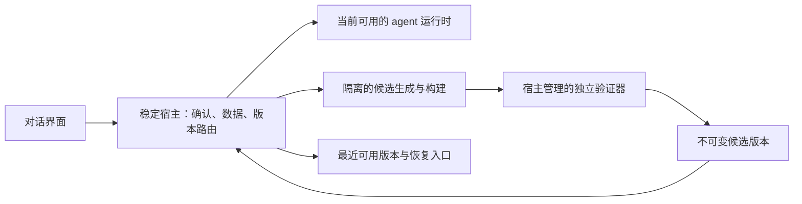

# 对话驱动的应用改进

状态：架构方案，尚未实现。2026-10-24。本轮只落实白色极简界面，不将现有源码合并功能描述成运行版本更新。

## 从使用结果定义功能

用户说“以后别显示头像，背景换成白色”，应用应先确认具体效果和是否需要刷新；确认后后台准备改动，验证通过再应用。准备失败时当前版本继续工作；应用失败时能回到最近可用版本，历史和输入保留。

当前断点很明确：普通对话不调用改进服务；现有“应用”只快进合并 Git；前端没有重新构建、运行版本没有切换；安装版还缺少源码仓库。因此继续增加提案页面，不能解决“改动没有用”的问题。

核心决策：**稳定宿主负责运行、数据和切换；agent 只生成候选版本。先准备替代品，再切换，始终保留最近可用版本。**

## 对话就是入口

只把用户本人针对 embuddies 的明确改动需求作为发起依据。区分“帮我把项目页面改白”和“把你的工作台改白”；不明确时只问清对象。网页、文档、工具输出和模型自己的建议不能代替用户授权。首版不做每轮额外反思调用，不把普通抱怨都变成升级提示。

模型可调用 `propose_app_change` 提交结构化意图；宿主负责持久化、校验和呈现，调用本身不能改文件或激活版本。意图包含来源消息、当前版本、预期行为、影响组件、权限范围、预计切换方式。风险和真正的切换方式由宿主根据实际产物重新计算。

最小交互示例：

> 改成白色背景，并隐藏对话头像。需要刷新界面，输入会保留。
>
> [按此修改] [调整方案] [暂不]

已支持的主题、字号、头像开关走经过校验的偏好设置，不生成代码。这条路径最短，也最可靠。新的交互或能力才进入候选构建。

代码改动确认分两步，各有明确用途：先确认方案，允许后台生成和验证；准备完毕后展示一张简短的“应用改动”卡，标明实际变化、验证结果和刷新/重启影响，由用户应用。完整差异和检查日志折叠查看。若需求或权限变化，回到方案确认；不按文件反复弹确认。不把“同意一个想法”等同于批准任何生成的代码。

后台准备不占用当前对话的执行队列；可以继续聊天、关闭提案或取消改动。只在需要决定、完成或失败时通知。

## 三个边界



| 边界 | 职责 | 为什么必须分开 |
|---|---|---|
| 稳定宿主 | 窗口与桥接、密钥服务、审批、数据、版本路由、启动恢复、冻结与回退 | 候选出错时仍有一个能恢复应用的控制者 |
| 可替换版本 | UI、agent 编排、模型适配、资源与经过限制的插件 | 允许用户改变产品行为，而不替换恢复机制 |
| 候选构建环境 | 在固定基线上改代码、构建产物、提交待验证结果 | 构建失败不能影响当前版本或读取私人数据 |

稳定宿主首版不允许 agent 修改；宿主升级走单独维护和验证的普通应用发布流程。保护名单、验证器、审批存储和版本切换代码由宿主提供，不能从候选目录加载。用户发起的应用改进也不能静默扩大本机权限。

当前 `desktop/main.cjs`、`desktop/runtime-supervisor.cjs` 和 preload 桥接已提供宿主与 worker 的起点；但 supervisor 当前是单 worker 的崩溃重启机制，不具备双版本切换能力。`runtime/record-database.mjs` 目前仍运行在 runtime 内，必须先将写入权限收口到宿主管理的数据服务，才能安全地让两个版本同时存在。

worktree 只隔离版本，不是操作系统沙箱。真正的权限边界需要单独的 Windows 受限执行身份与目录 ACL、进程和网络限制；仅使用不同目录、环境变量或 Job Object 的资源限制不够。若部署环境尚未提供可验证的隔离，首版只开放声明式偏好和受限资源更新，暂停自动执行生成的构建代码。

生成器通过受限模型代理取得响应，不能拿到原始 API Key；构建器和测试进程没有用户数据、模型凭据、浏览器档案或任意网络访问。插件不能因为位于 Skill/资源目录就被视为低风险：有可执行代码或新增工具权限时按代码升级验证和审批。

## 从源码到真正可运行的候选版本

1. 宿主记录基础版本和当前源码摘要。从与安装版本匹配的受控源码快照创建隔离副本；开发环境可以复用 Git worktree，安装版使用随版本分发或从可信发布源取得的源码包，不要求用户安装 Git。
2. 固定工具链、锁文件和预装依赖。构建命令来自宿主允许列表；候选不能添加任意安装脚本或自行下载工具。设置文件数、调用次数、CPU、内存、磁盘和时间预算。
3. 使用外部验证器运行类型检查、相关测试、构建和真实桌面冒烟；UI 必须验证布局、桥接、输入和核心对话，运行时必须验证流式输出、工具审批、取消和历史写回。构建通过只是必要条件。检查缺失、超时、产物缺失都算未通过。
4. 生成不可变候选目录及 manifest。证据由可信验证进程记录；候选自己的“测试通过”文件不作为依据。完成后再次校验内容摘要，防止验证后被替换。
5. 展示实际改动与激活影响。用户应用时，宿主核对批准的产物摘要、基础版本、权限、协议和数据兼容性；任何一项变化都失效重来。并发提案串行激活，过期基线不能覆盖后来的版本。

manifest 至少包含 `candidateId`、`baseVersion`、`sourceHash`、`artifactHashes`、`changedComponents`、`hostProtocolRange`、`dataSchemaRange`、`activationKind` 和 `evidenceIds`。本地摘要证明内容一致性，不证明发布者身份；下载的源码和工具链仍需可信发布校验。不可变目录与证据必须由构建进程无权修改的边界保护。

## 哪些改动需要重启

| 改动 | 应用方式 | 对当前使用的影响 |
|---|---|---|
| 已支持的外观偏好 | 校验后保存设置并立即渲染 | 不重启 |
| Skill / 声明式规则 | 创建资源版本，新回合使用新版本 | 正在执行的回合固定使用原版本 |
| UI 组件代码 | 独立候选窗口验证后保存视图状态，再重载界面 | 短暂刷新，后台任务继续 |
| agent 运行时 | 新 worker 预热验证；旧回合结束后，新回合路由到新版本 | 旧任务不强杀，不自动重放 |
| 宿主、原生模块或不兼容协议 | 退出前保存状态，显式确认后完整重启 | 明确告知需要短暂停用 |

纯 CSS 文件也不能任意注入活动页面；能用偏好完成的走偏好，代码更新统一经过 UI 验证和加载边界。先实现整组兼容的 UI/runtime 候选切换，避免一开始就支持任意组件组合；独立资源版本可以沿用现有机制。

UI 刷新前保存当前会话、每个会话的草稿、选区、滚动位置和已消费事件序号。新界面按序号补取事件并去重；审批状态来自宿主，不能依赖旧组件的内存。离屏候选不得发送真实工具请求或写真实数据。

运行时的请求、工具调用和事件都带 `generation`、`sessionId`、`runId` 与稳定的 `callId`。切换时停止向旧 worker 派发新回合，但让它完成已接任务；只有在相关会话空闲后才转交。旧任务超过等待时间时让用户选择继续等待或取消，不默认中止。兼容的独立会话可提前路由到新 worker。

副作用由宿主工具代理记录开始、完成和结果；审批绑定实际调用内容与所属 generation。崩溃后若无法确认工具是否已经写入或发送，不自动重试该调用。恢复状态显示为需检查，保留执行记录后由用户决定；无法对任意外部系统承诺 exactly-once。

## 数据和回退

历史、草稿、设置、密钥和决定记录位于独立用户数据目录，不放在版本目录里。宿主数据服务作为唯一写入入口，新旧 worker 都通过版本化 RPC 读写；候选验证使用样例数据副本。敏感密钥操作保留在宿主，worker 通过受限能力访问。

首版只允许向后兼容的增量数据变更，旧版本仍能读取切换后的数据。删除字段、破坏性迁移和不可逆格式变更不进入在线改进流程。版本回退切换代码和资源引用，**不恢复旧数据库覆盖新历史**。数据备份用于灾难恢复，需要单独明确其恢复时间点和数据损失范围。

宿主保存持久化激活日志、活动版本指针和 `lastKnownGood`。顺序为：记录准备激活 → 检查并保存会话状态 → 原子提交版本指针 → 启动候选并观察 → 标记稳定。文件系统指针和数据库不能假装属于一个事务；使用 journal 加启动对账处理每个中间状态。Windows 下要单独验证临时文件写入、持久化和替换语义，并处理文件占用导致的替换失败。

激活未完成或候选本地健康检查失败时回到已保留的可用版本，失败候选隔离，避免无限重启。保留至少一个已验证版本，正在承载任务的旧版本不可清理。候选验证失败、构建器退出、用户取消都不移动活动指针。

健康观察分开检查本地代码和远端模型：渲染崩溃、协议错误、存储写入失败触发本地恢复；供应商 500、限流、断网只触发连接错误处理，不能因此反复回退正确的代码。当前正在执行的任务结果先持久化，再解除旧版本引用。

SQLite 可提供事务记录，但同权限进程可改数据库，不能声称不可篡改。审计至少记录来源、方案、内容摘要、证据、确认人、激活阶段、故障和回退原因；需要防篡改证明时再设计独立权限和外部锚定。

## 持久化状态机

```text
requested → awaiting_plan_confirmation → building → validating
          → awaiting_apply_confirmation → staged → draining
          → activating → observing → active
```

生成阶段可进入 `cancelled / rejected / failed`；激活后可进入 `rolled_back`。每次状态推进持有提案版本号和候选摘要，重复按钮、重复事件不重复激活。宿主重启后先对账，未确认的提案保持待确认，未完成的生成可标记中断后重建，不能把“正在应用”直接当作成功。冻结立即阻止新生成和激活；已经开始的原子激活要先完成或回退到一致状态。

## 最短落地顺序

1. **偏好与对话提案**：主题/头像等偏好结构化；接入 `propose_app_change`，复用内联审批和现有资源版本。先让最常见需求真正生效。代码提案只生成、验证和展示，激活能力未完成时不能把“合并源码”标记为“已更新应用”。
2. **宿主数据与恢复基础**：收口数据写入，加入激活日志、启动对账、版本指针与最近可用版本；形成只读恢复入口。把当前构建脚本拆成可验证的候选构建步骤，完成隔离与安装版源码供应。
3. **UI 候选闭环**：真实构建、桌面验证、草稿和事件恢复、刷新激活、失败回退。先只允许 UI 和声明式资源，运行时保持固定。
4. **运行时交接**：版本化 RPC、generation 路由、任务排空和副作用恢复。经过故障注入后再开放运行时代码改动；宿主仍走普通版本升级。

本方案替代旧路线中“先做反思器/自动合入，再补运行版本切换”的顺序。用户价值来自改动能用、失败可恢复，优先完成这条闭环。连续测试通过的次数不能自动换来更大的本机权限。

## 必须通过的验收

- 普通对话提出改界面：方案确认、后台验证、应用后看到变化；全过程不需要寻找独立自进化页面。
- 不明确对象、网页夹带改动指令、单纯抱怨：不能自动改代码。
- 类型错误、白屏、桥接失效、伪造验证报告或验证后修改产物：均不能激活，当前对话继续可用。
- 构建器超时或被终止：活动版本和历史不变；安装版没有 Git 也能准备候选。
- UI 刷新时草稿、选区、滚动、待审批和流式事件恢复；候选窗口不执行真实操作。
- 有执行中的写操作时应用更新：旧任务能完成，不重复执行、不丢结果；无法判定的副作用要求人工检查。
- 在写日志、替换指针、启动候选等各个阶段强制退出：重启后恢复可用版本和一致状态，已产生的新历史仍在。
- 不兼容协议、破坏性迁移、宿主修改：在线改进拒绝；完整重启必须说明影响并取得确认。
- 供应商 500：保留历史并提供重试，不误判为候选代码故障。

“一直能用”的工程目标是后台准备失败不影响当前使用、更新失败有恢复路径、数据和任务不被静默丢弃。完整宿主重启、操作系统故障和远端模型中断仍可能暂停服务，不能承诺绝对零中断。
